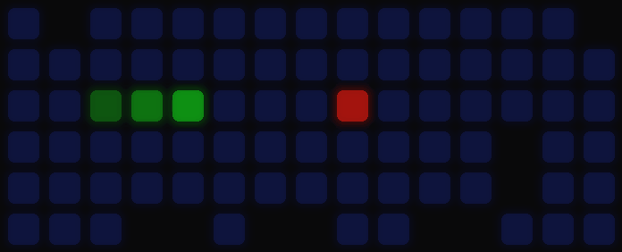

# aula-f75-gnome-topbar

Linux lighting control for the Aula F75 keyboard (wired USB-C, `258a:010c`), with a GNOME top-bar menu.

Live per-key animations streamed to the keyboard, a music visualiser, and the built-in effects, all from
the top bar, no vendor software, no root.

| snake | aurora | fire | twinkle |
|---|---|---|---|
|  |  |  |  |

<sub>Simulated with `./preview.py NAME SECONDS OUT.gif`: the same frames the keyboard gets, drawn on its 15×6 LED grid.</sub>

Unofficial: not affiliated with or endorsed by AULA. The protocol was worked out by studying the vendor's
Windows driver; no vendor code or files are included.

## Before you use it

This talks to the keyboard's firmware directly, with no vendor safety net. Read this first.

- **Tested on one keyboard only:** an Aula F75 (non-Max), wired, firmware 24, on GNOME 50 / Ubuntu.
  Other revisions, the F75 Max, or 2.4 GHz / Bluetooth mode are untested and not supported.
- **Known firmware crashes.** Effect 11 and config writes sent less than about a second apart make the
  keyboard drop off USB. It came back by itself each time with its settings intact. `aulactl` refuses
  effect 11 and spaces config writes 1.5 s apart; don't bypass that.
- **Flash wear.** Per-key colours (command `06`) are written to flash. `aulactl` never streams them;
  animations use the RAM-only live channel (`08`). If you hack on this, keep it that way.
- Back up first: `aulactl save ~/aula-backup.bin`; `aulactl restore` puts it back.
- No warranty (see [LICENSE](LICENSE)). If it bricks your keyboard, that's on you.

## Requirements

- GNOME Shell 50 (the only version tested)
- Python 3, the keyboard connected by USB-C in wired mode
- Optional, for the `music` and `pulse` animations: `numpy` and PipeWire's `pw-record`
  (Debian/Ubuntu: `sudo apt install python3-numpy pipewire-bin`)

## Install

```
git clone https://github.com/Kalakata/aula-f75-gnome-topbar
cd aula-f75-gnome-topbar
./install.sh    # links aulactl into ~/.local/bin and the extension into GNOME, installs the udev rule (sudo)
```

Then log out and back in once (GNOME on Wayland only loads new extensions at login).
The udev rule (`70-aula-f75.rules`) lets the user logged in at the machine control the lighting without sudo.
It only opens the keyboard's lighting interface, never the one that carries keystrokes, and uses the
seat-bound `uaccess` ACL instead of a group.

## Use

```
aulactl list | info | effect N|NAME | brightness N | speed N | color N | save FILE | restore FILE
aulactl animate [aurora|music|pulse|fire|twinkle|snake|scanner|heartbeat] [SECONDS]
```

The top-bar menu does the same: animations, live brightness and speed sliders, and the built-in effects.
Effect descriptions are built in; to rename any, put `{"7": "my name"}` in `~/.config/aula/effect-names.json`.

## Protocol

Recovered from the vendor driver (`AULA F75 Setup v2.0 20240509.exe` → `OemDrv.exe`, class `CDevG5KB`)
and verified on hardware. HID feature report ID 6, 520 bytes:

```
06 CMD SUB 00 NPAGES PAGE LEN_lo LEN_hi | payload (max 512)
```

Reads use `CMD | 0x80`. Write commands:

| cmd  | what                                   | notes |
|------|----------------------------------------|-------|
| `04` | config (0x80 bytes)                    | effect at buf `0x12`, per-effect `[brightness][speed<<4\|colour]` at `0x40+2n`, end marker `5a a5` |
| `06` | per-key colours, SUB = layer           | 378 bytes: R, G, B planes of 126; **saved to flash, never stream it** |
| `08` | live frame (music-mode channel)        | 378 bytes RGB interleaved; RAM only, safe at 30 fps |
| `0a` | colour presets                         | 7 RGB colours per effect; colour nibble 0-6 picks one, 7 = rainbow |
| `03`/`05`/`0b` | keymap / macros / screen params | not used here |

- LED index = column × 6 + row. The F75 has 15 columns (LED 0-89); row 0 is the F-key row.
- Effect 21 (Self-define) needs config byte `0x11` = 1 as well, or the board stays dark. Its brightness is byte `0x7d` (Fn+↑ changes it).
- Effect 11 crashes the firmware (USB re-enumerates); `aulactl` refuses it.

## License

MIT, see [LICENSE](LICENSE).
